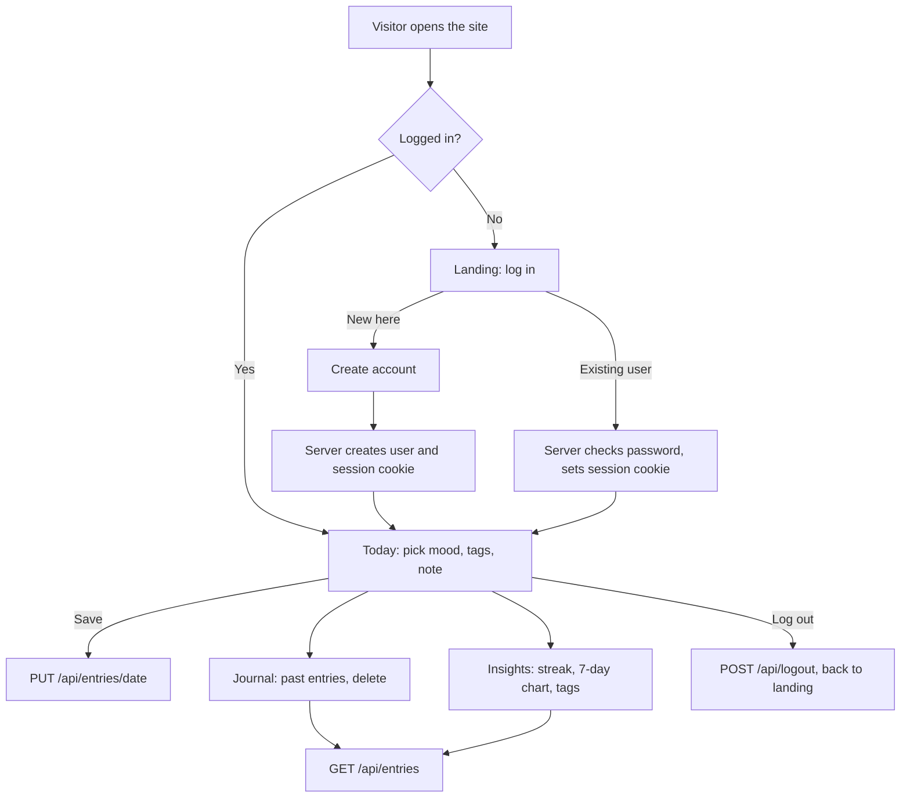

# DayFlow (website + backend)

A journal and mood tracker. People create an account, log how their day went, and see their history and mood patterns. Entries are stored on the server, so they follow the person to any device.

There is nothing to install except Node.js (version 18 or newer). The backend uses only Node's built-in modules.

## Run it

```
node server.js
```

Then open **http://localhost:3000**.

On Windows, open the folder in VS Code, open the terminal (Ctrl+`) and run the command above. Press Ctrl+C to stop it.

Options (environment variables):

| Variable | Default | What it does |
| --- | --- | --- |
| `PORT` | `3000` | Port to listen on |
| `HOST` | `127.0.0.1` (or `0.0.0.0` when `PORT` is set) | Use `0.0.0.0` to open it from your phone on the same Wi-Fi |
| `DATA_DIR` | `./data` | Where `db.json` is stored |
| `ADMIN_EMAIL` | none | The site owner's email. That account can remove posts from the Community feed. Sign up with this email first, because emails are not verified. |

PowerShell examples:

```
$env:PORT=3001; node server.js
$env:HOST="0.0.0.0"; node server.js
```

To open it on your phone over Wi-Fi, run with `HOST=0.0.0.0`, then browse to `http://YOUR-PC-IP:3000` (find the IP with `ipconfig`). Allow Node through the firewall if Windows asks.

## Website flow



## How the pieces connect

```
Browser (public/app.js)  ──fetch, JSON, session cookie──▶  server.js  ──▶  data/db.json
```

- `public/` is the website (HTML, CSS, JavaScript). The server hands these files to the browser.
- `server.js` is the backend. It checks logins, validates everything it receives, and reads and writes `data/db.json`.
- The front end never touches the data file. It only calls the API below.

## API

All requests and responses are JSON. Routes under "Needs login" return `401` without a valid session.

| Method and path | Needs login | Purpose |
| --- | --- | --- |
| `POST /api/signup` | no | `{name, email, password}` creates an account and logs in |
| `POST /api/login` | no | `{email, password}` logs in |
| `POST /api/logout` | no | Ends the session |
| `GET /api/me` | yes | Current user |
| `GET /api/entries` | yes | All of the user's entries, keyed by date |
| `PUT /api/entries/YYYY-MM-DD` | yes | `{mood 1-5, tags[], note, shared}` creates or replaces that day's entry. `shared` is false unless it is exactly `true` |
| `GET /api/feed` | yes | Entries that authors chose to share, newest first, with first name only |
| `DELETE /api/feed/ID` | owner only | Removes a post from the feed for good. The author keeps the private entry |
| `DELETE /api/entries/YYYY-MM-DD` | yes | Removes that day's entry |

## Community feed and privacy

- Every entry is private by default. A person can switch on "Share this entry" for any entry on the Today tab.
- Only shared entries appear on the Community tab, with the author's first name, mood, tags and note. Emails and other details are never sent.
- The owner (the account matching `ADMIN_EMAIL`) can remove a post from the feed. The author keeps their private entry but cannot share that entry again.
- The sign-up screen tells people their entries are private unless they share them. Keep that promise: the data file does contain everyone's private notes, so the owner should not read them.

## Public journal page

- `/read.html` shows the owner's shared entries to anyone with the link, with no login. The owner is the account whose email matches `ADMIN_EMAIL`, or, if that is not set, the **first account ever created**.
- The owner's new entries are set to post publicly by default (the box is ticked and says so). Untick it to keep an entry private.
- Set `ALLOW_SIGNUPS=false` after the first account exists to close sign-ups, so only the owner can post. On the free Render plan the data is wiped on redeploy, and then the next person to sign up becomes the owner, so sign up again straight away or set `ADMIN_EMAIL`.
- Only entries the owner marked "Share this entry" appear. Private entries, other users' entries, emails and ids are never sent. `GET /api/public` is the only route that works without login besides sign-up and login.
- To take an entry off the page, open it on the Today tab and turn sharing off, then save.

## What the backend already does for safety

- Passwords are hashed with scrypt and a per-user salt. Plain passwords are never stored.
- Sessions are random tokens in an HttpOnly cookie. Only a hash of each token is stored. They last 30 days.
- Every input is validated (email, password length, mood range, allowed tags, note length, real dates).
- Each user only ever reads and writes their own entries.
- Requests from other websites are rejected, and sign-up and login attempts are rate limited per address.
- Notes are shown as plain text in the page, so HTML typed into a note cannot run.

## Before putting it on the internet

This is a solid starting point, not a hardened production system.

- **Use HTTPS.** Hosts like Render, Railway or Fly.io provide it. The cookie is marked `Secure` automatically behind HTTPS.
- **Keep `data/` on persistent storage.** On most hosts the disk is wiped on each deploy unless you attach a volume. Point `DATA_DIR` at that volume.
- **The JSON file is fine for personal use or a small group.** For many users, replace the storage functions in `server.js` (`persist`, and reads of `db.users`, `db.entries`) with a real database such as SQLite or PostgreSQL.
- Behind a proxy, the rate limiter sees the proxy's address. Add per-user or forwarded-address limits if you expect abuse.
- There is no password reset or email verification yet.

## Files

```
server.js          Backend
package.json       Start script (npm start)
public/index.html  Page shell
public/style.css   Styles (light and dark)
public/app.js      Screens, and calls to the API
data/db.json       Created on first run
```
